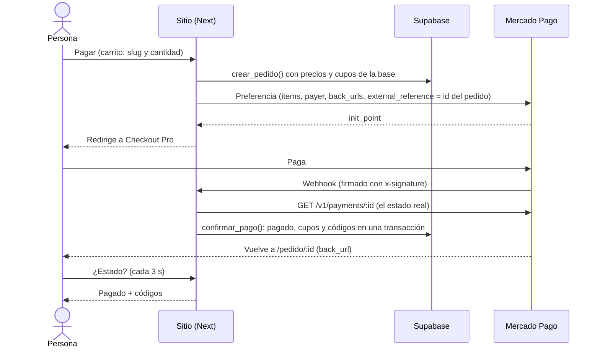

# Ámbar Recoleta

Sitio web para **Ámbar**, bar y restaurante en Junín 1725, frente al Cementerio de la Recoleta (Buenos Aires). Trabajo práctico de **Programación Web — ITBA, 2026**.

- **Producción:** [ambar-recoleta.vercel.app](https://ambar-recoleta.vercel.app)
- **Autor:** Ramón Eppens

> El sitio usa la marca y las fotos de Ámbar sin aprobación formal todavía. Por eso **no se indexa en buscadores** (`noindex`) hasta que el local lo apruebe. Las experiencias para regalar y la seña de eventos son contenido de demostración del TP: Ámbar hoy no las vende.

## Qué es

Ámbar se describe en su Instagram así: _"Somos tu cena, tu previa y, si pinta, todo lo que viene después."_ El sitio sigue esa frase. Cada página recorre la noche (tarde → cena → previa → noche) y el color acompaña la hora: crema, azul terciopelo y negro.

Hasta ahora el local solo tenía Instagram, con la carta y los horarios en historias que vencen a las 24 horas. El sitio los deja siempre disponibles y en dos idiomas, para el turista que está frente al Cementerio.

| Página       | Ruta                                           | Contenido                                                                                              |
| ------------ | ---------------------------------------------- | ------------------------------------------------------------------------------------------------------ |
| Inicio       | `/es`                                          | Portada, las tres cosas que se pueden hacer (comer, regalar, festejar) y cómo llegar                   |
| La carta     | `/es/carta`                                    | Carta aperitiva, de cena y tragos, con precios y horario de cada carta                                 |
| Visitanos    | `/es/espacio`                                  | El lugar (patio, salón y barra), la música (DJs y sets de Colonia Radio), horarios, croquis y reservas |
| Eventos      | `/es/eventos`                                  | Consulta por un evento privado: formulario con validación en vivo (demo del TP)                        |
| Carrito      | `/es/carrito`                                  | Carrito (localStorage) y pago con Mercado Pago Checkout Pro                                            |
| Cuenta       | `/es/ingresar` · `/es/registro` · `/es/cuenta` | Crear cuenta o ingresar (email o Google). "Mi cuenta": compras con sus códigos y consultas de eventos  |
| Para regalar | `/es/experiencias`                             | Catálogo de experiencias para regalar (demo del TP) y una página por experiencia                       |

Todas las páginas existen también en inglés (`/en/...`).

## Tecnologías

| Herramienta                                              | Uso                                                                                 |
| -------------------------------------------------------- | ----------------------------------------------------------------------------------- |
| [Next.js 16](https://nextjs.org) (App Router) + React 19 | Framework. Server Components por defecto; `"use client"` solo donde hay interacción |
| TypeScript                                               | Tipado estático                                                                     |
| CSS Modules + variables CSS                              | Estilos y sistema de diseño (`src/styles/tokens.css`)                               |
| `next/image`                                             | Fotos optimizadas (formato y tamaño según la pantalla)                              |
| [Supabase](https://supabase.com) (PostgreSQL)            | Base de datos, seguridad por filas (RLS) y autenticación                            |
| Zod                                                      | Validación de los datos que recibe la API                                           |
| Mercado Pago Checkout Pro                                | Pagos: preferencia, redirección y webhook firmado                                   |
| Vitest                                                   | Tests unitarios de la lógica y de la API                                            |
| PGlite                                                   | PostgreSQL en WebAssembly: corre las migraciones reales dentro de los tests         |
| ESLint + Prettier                                        | Calidad y formato de código                                                         |
| GitHub Actions                                           | Integración continua en cada PR                                                     |
| Lighthouse CI                                            | Auditoría de accesibilidad y performance en el CI                                   |
| Vercel                                                   | Despliegue continuo y preview por PR                                                |

No hay librerías de componentes ni de estilos: todo el diseño está hecho a mano a partir del material de Ámbar.

## Estructura

```
src/
├── app/
│   ├── [lang]/              # Todas las páginas, con el idioma como segmento dinámico
│   │   ├── layout.tsx       # Layout raíz: <html lang>, header, footer, metadata
│   │   ├── page.tsx         # Inicio
│   │   ├── carta/           # Incluye el buscador (CartaFiltrable, Client Component)
│   │   ├── espacio/
│   │   └── experiencias/    # Catálogo y [slug] (detalle)
│   ├── api/v1/              # API REST (Route Handlers)
│   ├── admin/               # Panel del admin (layout raíz propio)
│   ├── global-not-found.tsx # 404 propia (bilingüe)
│   ├── robots.ts            # robots.txt (bloquea hasta ALLOW_INDEXING=true)
│   └── icon.svg             # Favicon
├── components/              # Componentes reutilizables (Momento, Horarios, Navegacion…)
├── data/                    # Datos estáticos: fotos y enlaces externos
├── i18n/                    # Configuración de idiomas y diccionarios es.json / en.json
├── lib/
│   ├── api/                 # Esquemas de Zod y manejo de errores centralizado
│   ├── mercadopago.ts       # Preferencias, pagos y firma del webhook
│   ├── pagos.ts             # Conciliación: pago de MP → pedido en la base
│   ├── carrito.ts           # Carrito en localStorage
│   ├── catalogo.ts          # Búsqueda y filtros de la carta (los usan la API y el buscador)
│   ├── datos.ts             # Lecturas de Supabase (carta, horarios, sets, experiencias)
│   ├── mapear.ts            # Filas de la base → tipos del sitio (puro, testeado)
│   ├── supabase/            # Clientes de Supabase
│   └── …                    # Lógica pura y testeable (ahora, hora, precio, semana)
├── styles/                  # Tokens de diseño, reset y estilos base
└── proxy.ts                 # Redirige "/" al idioma del navegador
supabase/
├── migrations/              # SQL en orden: esquema → seguridad (RLS) → semilla → cambios
└── base-de-datos.test.ts    # Prueba las migraciones y las políticas RLS
```

## Decisiones de diseño y técnicas

- **Una sola fuente de verdad para los horarios** (tabla `horarios` en Supabase). La usan el indicador "Ahora", el pie, la carta, la home y Música. Si cambia un horario, cambia en todo el sitio.
- **Indicador "Ahora"** (carta aperitiva / cena / barra / cerrado). Usa la **hora de Buenos Aires** aunque el visitante esté en otra zona horaria, y entiende que el viernes a la 01:30 sigue siendo "la noche del viernes". Es un Client Component con `useSyncExternalStore`: en el build estático no existe "ahora", así que se calcula en el navegador.
- **Idiomas** con el patrón oficial de Next (`app/[lang]`). Los diccionarios están tipados: si a `en.json` le falta una clave de `es.json`, falla el typecheck.
- **Paleta tomada de su material** (isotipo, papel de la carta, cortina, almohadones del patio), con contraste verificado ≥ 4.5:1. Los componentes usan roles de color (`--bg`, `--fg`, `--accent`), y `data-mode="noche"` invierte una sección entera.
- **Tipografía:** Helvetica del sistema, la misma de su carta impresa. No descarga fuentes.
- **Fotos** optimizadas con `next/image` y textos alternativos en los dos idiomas. Si falta el `alt` de una foto, falla el typecheck.
- **Videos con patrón fachada:** se muestra la miniatura y el reproductor de YouTube carga recién al apretar play (`youtube-nocookie.com`).
- **Croquis SVG** de la cuadra en lugar de un iframe de Google Maps: pesa casi nada y no carga scripts de terceros.

## Base de datos

PostgreSQL en Supabase. Las migraciones están en `supabase/migrations/` y se ejecutan **en orden** en el SQL Editor de Supabase.


**Seguridad (Row Level Security).** Todas las tablas tienen RLS activado, con una política por operación:

| Quién                    | Puede                                                                       |
| ------------------------ | --------------------------------------------------------------------------- |
| Visitante (anónimo)      | Leer la carta, los horarios, los sets publicados y las experiencias activas |
| Usuario con rol `admin`  | Además: crear, editar y borrar el catálogo; leer consultas y pedidos        |
| Servidor (clave secreta) | Crear consultas y pedidos después de validarlos, y confirmar pagos          |

Nadie puede crear un pedido o una consulta directamente desde el navegador: solo pasando por la API, que valida los datos.

**`confirmar_pago()`** marca un pedido como pagado, descuenta los cupos y genera los códigos de regalo **en una sola transacción**. Si no alcanza el stock, se revierte todo. Si Mercado Pago avisa dos veces el mismo pago, la segunda llamada no hace nada.

**Pruebas.** `supabase/base-de-datos.test.ts` corre todas las migraciones sobre un PostgreSQL real (PGlite) y verifica las políticas actuando como visitante, usuario común y admin. Corre en cada PR.

## API

API REST en `/api/v1`, con Route Handlers de Next (el equivalente a las rutas de Express de la clase 10). Los recursos van en plural y la acción la da el verbo HTTP.

| Método y ruta                                         | Qué devuelve                                                                      | Parámetros                                                                    |
| ----------------------------------------------------- | --------------------------------------------------------------------------------- | ----------------------------------------------------------------------------- |
| `GET /api/v1/platos`                                  | Platos y tragos activos                                                           | `carta` (`aperitivo`, `cena`, `tragos`), `q`, `precioMax`, `pagina`, `limite` |
| `GET /api/v1/platos/:slug`                            | Un plato, con su carta y sección                                                  | —                                                                             |
| `GET /api/v1/experiencias`                            | Experiencias a la venta, con los cupos al momento                                 | —                                                                             |
| `GET /api/v1/experiencias/:slug`                      | Una experiencia                                                                   | —                                                                             |
| `POST /api/v1/platos` · `/experiencias`               | Crea (solo admin) → 201                                                           | Cuerpo JSON validado con Zod                                                  |
| `PATCH /api/v1/platos/:slug` · `/experiencias/:slug`  | Cambia los campos enviados (solo admin)                                           | Cuerpo JSON parcial                                                           |
| `POST /api/v1/pedidos`                                | Crea el pedido con los precios de la base y devuelve la URL de Checkout Pro → 201 | `{ nombre, email, items: [{ slug, cantidad }], idioma }`                      |
| `GET /api/v1/pedidos/:id`                             | Estado del pedido (los códigos, recién pagado)                                    | —                                                                             |
| `POST /api/v1/pedidos/:id/pago`                       | Nueva URL de pago para un pedido pendiente (señas)                                | `{ idioma }`                                                                  |
| `POST /api/v1/pedidos/:id/verificar`                  | Verifica un pago contra Mercado Pago (página de vuelta)                           | `{ paymentId }`                                                               |
| `POST /api/v1/webhooks/mercadopago`                   | Aviso de Mercado Pago, con la firma validada                                      | Lo llama Mercado Pago                                                         |
| `POST /api/v1/consultas/:id/sena`                     | Pide la seña de un evento (solo admin) → link de pago                             | `{ monto }`                                                                   |
| `GET /api/v1/sesion`                                  | Quién está logueado (nombre y email) o `null`                                     | —                                                                             |
| `POST /api/v1/consultas`                              | Guarda una consulta de evento → 201                                               | Cuerpo JSON validado con Zod                                                  |
| `PATCH /api/v1/consultas/:id`                         | Cambia el estado de una consulta (solo admin)                                     | `{ "estado": "contactada" }`                                                  |
| `DELETE /api/v1/platos/:slug` · `/experiencias/:slug` | Borra (solo admin) → 204                                                          | —                                                                             |

Ejemplo: `/api/v1/platos?q=ciervo&precioMax=30000` → `{ "datos": [...], "total": 2, "pagina": 1, "limite": 50 }`

**Validación.** Cada parámetro se valida con un esquema de Zod (`src/lib/api/esquemas.ts`). Un parámetro desconocido o mal escrito también es un error.

**Errores.** Todas las rutas pasan por `conErrores` (`src/lib/api/respuestas.ts`), que responde siempre con la misma forma:

```json
{
  "error": {
    "codigo": "datos_invalidos",
    "mensaje": "…",
    "detalles": [{ "campo": "precioMax", "mensaje": "…" }]
  }
}
```

| Código | Cuándo                                                                                      |
| ------ | ------------------------------------------------------------------------------------------- |
| 400    | Parámetros inválidos, con el detalle de cada campo                                          |
| 401    | Escritura sin sesión                                                                        |
| 403    | Escritura con sesión, pero sin rol `admin`                                                  |
| 404    | El plato o la experiencia no existe                                                         |
| 409    | Slug repetido, borrar una experiencia vendida, o sin cupos al comprar                       |
| 502    | Mercado Pago no respondió al crear el pago                                                  |
| 500    | Falla inesperada (por ejemplo, la base no responde). El detalle va al log, nunca al cliente |

**Quién la usa.** La página de cada experiencia es estática, pero pide sus cupos en vivo a `/api/v1/experiencias/:slug`, porque el stock cambia con cada compra. El buscador de la carta usa la misma función de búsqueda que `/api/v1/platos` (`src/lib/catalogo.ts`).

## Pagos (Mercado Pago Checkout Pro)



- **El navegador nunca decide el precio ni el estado.** El carrito manda solo qué y cuánto; `crear_pedido()` pone los precios de la base. El pedido pasa a pagado solo cuando el servidor le pregunta a Mercado Pago (`GET /v1/payments/:id`), nunca por la URL de vuelta.
- **Webhook seguro:** valida la firma HMAC-SHA256 (`x-signature`) con la clave secreta del webhook; si no coincide, 401. Responde 500 si algo falla de nuestro lado, para que Mercado Pago reintente.
- **Idempotente:** si el aviso llega dos veces, `confirmar_pago()` no hace nada la segunda. Si lo cobrado no coincide con el total, no se confirma.
- **Si el webhook se demora**, la página de vuelta pide `POST /pedidos/:id/verificar` con el id del pago, y el servidor lo verifica contra Mercado Pago de la misma forma.
- **Stock:** se controla al crear el pedido (aviso temprano) y otra vez al confirmar (`check (cupos >= 0)`). Si se agotó mientras pagaba, el pedido se cancela y queda en el log para devolver el dinero.
- **Señas:** el admin pide la seña de una consulta con el monto acordado; `crear_sena()` crea el pedido y da el link `/es/sena/:id` para el cliente. Al pagarse, la consulta queda "señada".

**Para probar:** se paga con la cuenta de prueba compradora de Mercado Pago, en una ventana de incógnito. El webhook se configura en la app de la cuenta de prueba vendedora (Tus integraciones → Webhooks → evento _Pagos_) apuntando a `https://<dominio>/api/v1/webhooks/mercadopago`.

## Cuentas de clientes

- **Opcionales:** se puede comprar y consultar sin cuenta. Con cuenta, las compras (con sus códigos) y las consultas quedan en **Mi cuenta**, y los formularios vienen completos.
- **Email y contraseña o Google** (Supabase Auth). Google usa OAuth con PKCE: vuelve a `/auth/callback` con un código de un solo uso que se cambia por la sesión.
- **La sesión va en una cookie `httpOnly`**: el JavaScript del navegador no puede leerla. Las páginas son estáticas; el menú pregunta quién está logueado a `/api/v1/sesion`.
- **RLS:** cada cliente lee solo sus pedidos, sus ítems y sus consultas (`usuario_id = auth.uid()`); escribir sigue siendo solo del servidor.
- **Sin "open redirect":** a dónde volver después de ingresar (`?siguiente=`) solo acepta rutas internas del sitio.

**Configuración (una vez):** Supabase → Authentication → Sign In / Providers → Google (Client ID y secreto de Google Cloud), _Confirm email_ apagado, y en URL Configuration el Site URL y las Redirect URLs del sitio, local y previews.

## Admin

Panel en `/admin` para editar la carta y las experiencias sin tocar código, ver las consultas de eventos (y pedir la seña) y los pedidos. Es un layout raíz aparte (sin idioma, nunca se indexa).

- **Ingreso** con email y contraseña de Supabase Auth. La sesión queda en una cookie `httpOnly` (`@supabase/ssr`), que el JavaScript del navegador no puede leer.
- **Tres barreras**: el proxy manda al ingreso a quien no tiene sesión; el panel y la API exigen el rol `admin` (401 / 403); y RLS en la base rechaza cualquier escritura de alguien que no sea admin.
- **Formularios** controlados: validan mientras se escribe con el mismo esquema de Zod que usa la API (`src/lib/esquemas.ts`), envían con `fetch` y muestran carga, error y los errores de la API en cada campo.
- **Al guardar**, el sitio público se regenera en la próxima visita (`revalidatePath`), sin esperar la hora del ISR.

**Crear el primer admin:** en Supabase → Authentication → Users → _Add user_ (con email y contraseña, _Auto Confirm User_). Después, en el SQL Editor:

```sql
update perfiles set rol = 'admin'
where id = (select id from auth.users where email = 'tu@email.com');
```

## Accesibilidad

- HTML semántico (`header`, `nav`, `main`, `section`, `address`, `dl`) y un único `h1` por página.
- Enlace "Saltar al contenido", foco visible y navegación completa con teclado.
- Menú móvil con `aria-expanded`; Escape lo cierra y devuelve el foco al botón.
- El buscador de la carta tiene etiqueta y anuncia la cantidad de resultados a los lectores de pantalla (`aria-live`).
- `prefers-reduced-motion` respetado.
- El CI **bloquea el merge** si la accesibilidad de Lighthouse baja de 95 (inicio, carta, catálogo y una experiencia).

## Cómo correrlo

Requisitos: Node.js 24 (ver `.nvmrc`) y un proyecto de Supabase.

1. En el **SQL Editor** de Supabase, ejecutar en orden los archivos de `supabase/migrations/` (el número del nombre marca el orden).
2. Copiar `.env.example` como `.env.local` y completar las claves (Supabase → Project Settings → API Keys).
3. Instalar y correr:

```bash
npm install
npm run dev        # http://localhost:3000
```

| Script              | Qué hace                                    |
| ------------------- | ------------------------------------------- |
| `npm run dev`       | Servidor de desarrollo                      |
| `npm run build`     | Build de producción                         |
| `npm run lint`      | ESLint                                      |
| `npm run typecheck` | Genera los tipos de rutas y corre `tsc`     |
| `npm test`          | Tests (Vitest): lógica, API y base de datos |
| `npm run format`    | Formatea con Prettier                       |

### Variables de entorno

| Variable                               | Dónde                                 | Para qué                                                                                         |
| -------------------------------------- | ------------------------------------- | ------------------------------------------------------------------------------------------------ |
| `NEXT_PUBLIC_SUPABASE_URL`             | `.env.local`, Vercel y GitHub Secrets | URL del proyecto de Supabase                                                                     |
| `NEXT_PUBLIC_SUPABASE_PUBLISHABLE_KEY` | `.env.local`, Vercel y GitHub Secrets | Clave publicable: solo puede lo que RLS permite                                                  |
| `SUPABASE_SECRET_KEY`                  | `.env.local` y Vercel (tipo Secret)   | Clave secreta: saltea RLS. Solo la usa el servidor para guardar consultas y pedidos ya validados |
| `MP_ACCESS_TOKEN`                      | `.env.local` y Vercel (tipo Secret)   | Access Token de Mercado Pago (cuenta de prueba vendedora): crea preferencias y consulta pagos    |
| `MP_WEBHOOK_SECRET`                    | `.env.local` y Vercel (tipo Secret)   | Clave del webhook de Mercado Pago: valida la firma de cada aviso                                 |
| `SITIO_URL`                            | Vercel (producción)                   | URL pública para las `back_urls` (sin definir: la del pedido)                                    |
| `ALLOW_INDEXING`                       | Vercel (producción)                   | `true` habilita la indexación en buscadores. Sin definir: `noindex`                              |

Las variables con prefijo `NEXT_PUBLIC_` llegan al navegador; las demás quedan solo en el servidor. Las claves nunca se suben al repositorio (`.env*` está en `.gitignore`).

## Flujo de trabajo

- `main` está protegida: solo se modifica por **pull request** con el check `checks` en verde.
- Cada PR corre en GitHub Actions: formato → lint → tipos → tests (incluida la base de datos) → build → Lighthouse (`/es` y `/en`). Las claves de Supabase llegan al CI como GitHub Secrets.
- Las páginas se generan estáticas en el build y se regeneran como mucho cada hora (ISR).
- Vercel despliega un **preview** por PR y **producción** en cada merge a `main`.
- Commits con prefijos (`feat:`, `fix:`, `chore:`, `ci:`, `docs:`) y una plantilla de PR con checklist.

## Entregables

| Entregable                                        | Estado |
| ------------------------------------------------- | ------ |
| E1 · Repo + pipeline + preview                    | ✅     |
| E2 · Landing + vistas clave responsivas           | ✅     |
| E3 · Formularios dinámicos con fetch + validación | ✅     |
| E4 · Catálogo navegable + API básica              | ✅     |
| E5 · CRUD en Supabase + admin                     | ✅     |
| E6 · Checkout + webhook                           | ✅     |

## Créditos

Marca, fotos y carta: **Ámbar Recoleta** ([@ambar.recoleta](https://www.instagram.com/ambar.recoleta/)). Sets: **Colonia Radio**. Uso con fines académicos.
