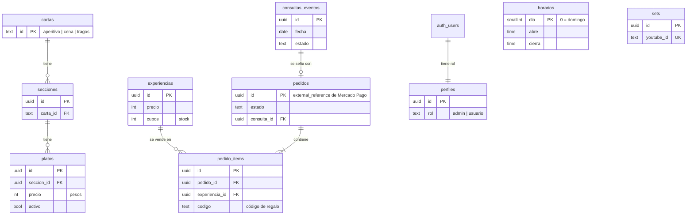

# Ámbar Recoleta

Sitio web para **Ámbar**, bar y restaurante en Junín 1725, frente al Cementerio de la Recoleta (Buenos Aires). Trabajo práctico de **Programación Web — ITBA, 2026**.

- **Producción:** [ambar-recoleta.vercel.app](https://ambar-recoleta.vercel.app)
- **Autor:** Ramón Eppens

> El sitio usa la marca y las fotos de Ámbar sin aprobación formal todavía. Por eso **no se indexa en buscadores** (`noindex`) hasta que el local lo apruebe. Las experiencias para regalar y la seña de eventos son contenido de demostración del TP: Ámbar hoy no las vende.

## Qué es

Ámbar se describe en su Instagram así: _"Somos tu cena, tu previa y, si pinta, todo lo que viene después."_ El sitio sigue esa frase. Cada página recorre la noche (tarde → cena → previa → noche) y el color acompaña la hora: crema, azul terciopelo y negro.

Hasta ahora el local solo tenía Instagram, con la carta y los horarios en historias que vencen a las 24 horas. El sitio los deja siempre disponibles y en dos idiomas, para el turista que está frente al Cementerio.

| Página     | Ruta          | Contenido                                                                                                  |
| ---------- | ------------- | ---------------------------------------------------------------------------------------------------------- |
| Inicio     | `/es`         | La noche en cuatro momentos, platos y tragos destacados                                                    |
| La carta   | `/es/carta`   | Carta aperitiva, de cena y tragos, con precios y horario de cada carta                                     |
| El espacio | `/es/espacio` | Patio, salón y barra. Al final, **Visitanos**: croquis de la cuadra, horarios, reservas y eventos privados |
| Música     | `/es/musica`  | DJs de viernes y sábado, Colonia Radio y los sets grabados en Ámbar                                        |

Todas las páginas existen también en inglés (`/en/...`).

## Tecnologías

| Herramienta                                              | Uso                                                                                 |
| -------------------------------------------------------- | ----------------------------------------------------------------------------------- |
| [Next.js 16](https://nextjs.org) (App Router) + React 19 | Framework. Server Components por defecto; `"use client"` solo donde hay interacción |
| TypeScript                                               | Tipado estático                                                                     |
| CSS Modules + variables CSS                              | Estilos y sistema de diseño (`src/styles/tokens.css`)                               |
| `next/image`                                             | Fotos optimizadas (formato y tamaño según la pantalla)                              |
| [Supabase](https://supabase.com) (PostgreSQL)            | Base de datos, seguridad por filas (RLS) y autenticación                            |
| Vitest                                                   | Tests unitarios de la lógica (horarios, precios, links)                             |
| PGlite                                                   | PostgreSQL en WebAssembly: corre las migraciones reales dentro de los tests         |
| ESLint + Prettier                                        | Calidad y formato de código                                                         |
| GitHub Actions                                           | Integración continua en cada PR                                                     |
| Lighthouse CI                                            | Auditoría de accesibilidad y performance en el CI                                   |
| Vercel                                                   | Despliegue continuo y preview por PR                                                |

No hay librerías de componentes ni de estilos: todo el diseño está hecho a mano a partir del material de Ámbar.

## Estructura

```
src/
├── app/
│   ├── [lang]/              # Todas las páginas, con el idioma como segmento dinámico
│   │   ├── layout.tsx       # Layout raíz: <html lang>, header, footer, metadata
│   │   ├── page.tsx         # Inicio
│   │   ├── carta/
│   │   ├── espacio/
│   │   └── musica/
│   ├── global-not-found.tsx # 404 propia (bilingüe)
│   ├── robots.ts            # robots.txt (bloquea hasta ALLOW_INDEXING=true)
│   └── icon.svg             # Favicon
├── components/              # Componentes reutilizables (Momento, Horarios, Navegacion…)
├── data/                    # Datos estáticos: fotos y enlaces externos
├── i18n/                    # Configuración de idiomas y diccionarios es.json / en.json
├── lib/
│   ├── datos.ts             # Lecturas de Supabase (carta, horarios, sets, experiencias)
│   ├── mapear.ts            # Filas de la base → tipos del sitio (puro, testeado)
│   ├── supabase/            # Clientes de Supabase
│   └── …                    # Lógica pura y testeable (ahora, hora, precio, semana)
├── styles/                  # Tokens de diseño, reset y estilos base
└── proxy.ts                 # Redirige "/" al idioma del navegador
supabase/
├── migrations/              # SQL: esquema → seguridad (RLS) → semilla
└── base-de-datos.test.ts    # Prueba las migraciones y las políticas RLS
```

## Decisiones de diseño y técnicas

- **Una sola fuente de verdad para los horarios** (tabla `horarios` en Supabase). La usan el indicador "Ahora", el pie, la carta, la home y Música. Si cambia un horario, cambia en todo el sitio.
- **Indicador "Ahora"** (carta aperitiva / cena / barra / cerrado). Usa la **hora de Buenos Aires** aunque el visitante esté en otra zona horaria, y entiende que el viernes a la 01:30 sigue siendo "la noche del viernes". Es un Client Component con `useSyncExternalStore`: en el build estático no existe "ahora", así que se calcula en el navegador.
- **Idiomas** con el patrón oficial de Next (`app/[lang]`). Los diccionarios están tipados: si a `en.json` le falta una clave de `es.json`, falla el typecheck.
- **Paleta tomada de su material** (isotipo, papel de la carta, cortina, almohadones del patio), con contraste verificado ≥ 4.5:1. Los componentes usan roles de color (`--bg`, `--fg`, `--accent`), y `data-mode="noche"` invierte una sección entera.
- **Tipografía:** Helvetica del sistema, la misma de su carta impresa. No descarga fuentes.
- **Fotos** optimizadas con `next/image` y textos alternativos en los dos idiomas. Si falta el `alt` de una foto, falla el typecheck.
- **Videos con patrón fachada:** se muestra la miniatura y el reproductor de YouTube carga recién al apretar play (`youtube-nocookie.com`).
- **Croquis SVG** de la cuadra en lugar de un iframe de Google Maps: pesa casi nada y no carga scripts de terceros.

## Base de datos

PostgreSQL en Supabase. Las migraciones están en `supabase/migrations/` y se ejecutan **en orden** en el SQL Editor de Supabase.



**Seguridad (Row Level Security).** Todas las tablas tienen RLS activado, con una política por operación:

| Quién                    | Puede                                                                       |
| ------------------------ | --------------------------------------------------------------------------- |
| Visitante (anónimo)      | Leer la carta, los horarios, los sets publicados y las experiencias activas |
| Usuario con rol `admin`  | Además: crear, editar y borrar el catálogo; leer consultas y pedidos        |
| Servidor (clave secreta) | Crear consultas y pedidos después de validarlos, y confirmar pagos          |

Nadie puede crear un pedido o una consulta directamente desde el navegador: solo pasando por la API, que valida los datos.

**`confirmar_pago()`** marca un pedido como pagado, descuenta los cupos y genera los códigos de regalo **en una sola transacción**. Si no alcanza el stock, se revierte todo. Si Mercado Pago avisa dos veces el mismo pago, la segunda llamada no hace nada.

**Pruebas.** `supabase/base-de-datos.test.ts` corre las tres migraciones sobre un PostgreSQL real (PGlite) y verifica las políticas actuando como visitante, usuario común y admin. Corre en cada PR.

## Accesibilidad

- HTML semántico (`header`, `nav`, `main`, `section`, `address`, `dl`) y un único `h1` por página.
- Enlace "Saltar al contenido", foco visible y navegación completa con teclado.
- Menú móvil con `aria-expanded`; Escape lo cierra y devuelve el foco al botón.
- `prefers-reduced-motion` respetado.
- El CI **bloquea el merge** si la accesibilidad de Lighthouse baja de 95.

## Cómo correrlo

Requisitos: Node.js 24 (ver `.nvmrc`) y un proyecto de Supabase.

1. En el **SQL Editor** de Supabase, ejecutar en orden los tres archivos de `supabase/migrations/`.
2. Copiar `.env.example` como `.env.local` y completar las claves (Supabase → Project Settings → API Keys).
3. Instalar y correr:

```bash
npm install
npm run dev        # http://localhost:3000
```

| Script              | Qué hace                                |
| ------------------- | --------------------------------------- |
| `npm run dev`       | Servidor de desarrollo                  |
| `npm run build`     | Build de producción                     |
| `npm run lint`      | ESLint                                  |
| `npm run typecheck` | Genera los tipos de rutas y corre `tsc` |
| `npm test`          | Tests unitarios (Vitest)                |
| `npm run format`    | Formatea con Prettier                   |

### Variables de entorno

| Variable                               | Dónde                                 | Para qué                                                            |
| -------------------------------------- | ------------------------------------- | ------------------------------------------------------------------- |
| `NEXT_PUBLIC_SUPABASE_URL`             | `.env.local`, Vercel y GitHub Secrets | URL del proyecto de Supabase                                        |
| `NEXT_PUBLIC_SUPABASE_PUBLISHABLE_KEY` | `.env.local`, Vercel y GitHub Secrets | Clave publicable: solo puede lo que RLS permite                     |
| `ALLOW_INDEXING`                       | Vercel (producción)                   | `true` habilita la indexación en buscadores. Sin definir: `noindex` |

Las variables con prefijo `NEXT_PUBLIC_` llegan al navegador; las demás quedan solo en el servidor. Las claves nunca se suben al repositorio (`.env*` está en `.gitignore`).

## Flujo de trabajo

- `main` está protegida: solo se modifica por **pull request** con el check `checks` en verde.
- Cada PR corre en GitHub Actions: formato → lint → tipos → tests (incluida la base de datos) → build → Lighthouse (`/es` y `/en`). Las claves de Supabase llegan al CI como GitHub Secrets.
- Las páginas se generan estáticas en el build y se regeneran como mucho cada hora (ISR).
- Vercel despliega un **preview** por PR y **producción** en cada merge a `main`.
- Commits con prefijos (`feat:`, `fix:`, `chore:`, `ci:`, `docs:`) y una plantilla de PR con checklist.

## Entregables

| Entregable                                        | Estado                                  |
| ------------------------------------------------- | --------------------------------------- |
| E1 · Repo + pipeline + preview                    | ✅                                      |
| E2 · Landing + vistas clave responsivas           | ✅                                      |
| E3 · Formularios dinámicos con fetch + validación | En curso                                |
| E4 · Catálogo navegable + API básica              | En curso                                |
| E5 · CRUD en Supabase + admin                     | Base de datos y RLS ✅ · admin en curso |
| E6 · Checkout + webhook                           | En curso                                |

## Créditos

Marca, fotos y carta: **Ámbar Recoleta** ([@ambar.recoleta](https://www.instagram.com/ambar.recoleta/)). Sets: **Colonia Radio**. Uso con fines académicos.
